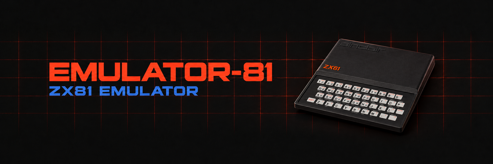

# Emulator-81



Emulator-81 is an experimental Sinclair ZX81 emulator built with Rust and
Macroquad. It is designed for native Linux use and also targets Windows and
macOS. The project explores ZX81 hardware, retro computing and AI-assisted
development.

The emulator loads `rom/zx81.rom` automatically when available. Without a ROM,
it displays a visual simulation but cannot run programs. Emulation is not
cycle-accurate, and software compatibility is not guaranteed.

Emulator-81 was conceived, designed and developed by Neil Feltham using
Microsoft Copilot AI, with architectural planning, testing and iterative
refinement.

## Features

- Selectable 1K or 16K RAM and an optional RAM Pack wobble simulation.
- Standard or instant loading of `.p` programs, including a games library.
- WAV tape import and export, with optional sound during standard loading.
- A virtual keyboard, CRT effects, fullscreen mode and CRT screenshots.
- Pause, single-step, reset and a CPU debug overlay.

Historical CRT development notes and test plans are in the
[CRT documentation folder](Project%20Documentation/CRT/).

## Build and run

Install a current stable Rust toolchain and run from the project directory:

```sh
cargo run --release
```

To select a different legally obtained 8 KB ZX81 ROM:

```sh
cargo run --release -- --rom /path/to/zx81.rom
```

Linux builds require X11/XCB development libraries, ALSA development libraries
(`libasound2-dev`) and a graphical session. File dialogs use the XDG desktop
portal, with Zenity as a fallback. macOS builds require an Apple toolchain and
SDK; no macOS installer is currently provided.

## Release packages

The packages in `dist/` include the ROM, artwork and games library. Rebuild
them to include later source or artwork changes.

### Linux AppImage

```sh
chmod +x dist/Emulator-81-x86_64.AppImage
./dist/Emulator-81-x86_64.AppImage
```

The AppImage requires a graphical session, compatible graphics and X11/XCB or
Wayland libraries, ALSA, and glibc 2.39 or newer. If FUSE is unavailable, pass
`--appimage-extract-and-run` before other arguments. On Wayland, desktop
integration (for example with AppImageLauncher) may be needed to display the
application icon in the taskbar.

### Linux Flatpak

Install the bundle and its GNOME 51 runtime from Flathub:

```sh
flatpak remote-add --user --if-not-exists flathub https://flathub.org/repo/flathub.flatpakrepo
flatpak install --user dist/Emulator-81-x86_64.flatpak
flatpak run io.github.felthamn136.Emulator81
```

### Linux Snap

The locally built Snap is unsigned. Install only a bundle you trust:

```sh
sudo snap install mesa-2604
sudo snap install --dangerous dist/Emulator-81-x86_64.snap
snap run emulator-81
```

The Snap uses the `core26` base and the `mesa-2604` graphics provider. If the
graphics plug is not connected automatically, run:

```sh
sudo snap connect emulator-81:gpu-2604 mesa-2604:gpu-2604
```

### Windows installer

Run `dist/Emulator-81-Setup.msi`. The unsigned installer may trigger a Windows
warning. An optional desktop shortcut is available during setup and is removed
on uninstall.

Uninstall any older NSIS-based installation first; the WiX installer does not
replace it automatically. The default installation folder is
`C:\Program Files\Emulator-81`. To choose another folder:

```powershell
msiexec /i dist\Emulator-81-Setup.msi INSTALLFOLDER="C:\Emulator-81"
```

### Windows portable

Extract `dist/Emulator-81-Windows-Portable-x86_64.zip` and run
`zx81_emulator.exe`. Keep the `assets`, `rom` and `Games Library` folders
alongside the executable.

Alternatively, `dist/Emulator-81-Portable-Setup.msi` installs a separate
per-user copy under `%LOCALAPPDATA%\Emulator-81 Portable`, with the same
optional desktop shortcut. Set `INSTALLFOLDER` with `msiexec` to choose another
location. The MSI registers an installation with Windows; use the ZIP if you
do not want an installation.

Windows builds do not open a console, so diagnostics written only to stderr
may not be visible when launched from the desktop.

### Rebuilding packages

Run `sh packaging/build-release.sh` to rebuild the AppImage, Windows WiX
installers and portable ZIP. It requires `appimagetool`, `zip`, WiX 5, the
`x86_64-pc-windows-gnu` Rust target, and a MinGW-w64 cross-compiler and
resource compiler (`x86_64-w64-mingw32-windres`). Windows MSVC builds require
`rc.exe` from the Windows SDK. On Linux, `WIX` may point to a wrapper that runs
WiX under Wine and translates paths; Wine is not an officially supported WiX
host.

To rebuild Flatpak and Snap on an x86-64 Ubuntu 26.04 host, install Cargo,
Flatpak, Snap, `apt-get`, `dpkg-deb`, `mksquashfs` and the Flatpak
`org.gnome.Sdk//51` and `org.gnome.Platform//51` runtimes, then run:

```sh
sh packaging/build-linux-bundles.sh /path/to/a/new/build-directory
```

The script downloads the Snap's Ubuntu dependencies and leaves intermediate
files in the build directory. Both release scripts respect `CARGO_TARGET_DIR`.

## Using the emulator

### Loading and saving programs

With a ROM loaded, choose **File > Load Program (.p)** or drop a `.p` file onto
the window. **File > Open File Instantly** skips tape timing and requires a
compatible ROM. The games library offers both loading modes.

Loading resets the machine and discards the current program. Files too large
for the selected RAM are rejected before reset; select 16K for larger
programs. Programs with a self-start line can start automatically; otherwise,
the emulator enters `RUN` after loading. The machine pauses while a file dialog
is open.

**Settings > Tape loading sound** enables audio during standard loading. It is
off by default; enabling it runs standard loading at tape speed. Instant loads
remain silent. Audio initialization failures are reported and loading continues
without sound.

To save a BASIC program, finish entering the current line, return to the K
prompt and choose **File > Save Program (.p)**. This saves the program and
system variables, not a complete emulator save state. Loading it resets the
machine and runs the program.

**File > Save Program as WAV...** exports the same SAVE memory range as mono
44.1 kHz, 16-bit PCM, adding `.wav` if the filename has no extension. It uses
an unnamed tape header for `LOAD ""`, with a five-second tone, one second of
silence and a one-second trailing tone. The tones are for playback convenience;
the original ZX81 ROM uses a silent leader.

**File > Load WAV Tape...** decodes mono or stereo 8- or 16-bit PCM at 22.05,
44.1 or 48 kHz, including WAV files exported by the emulator. Decoding runs in
the background; successful decoding then resets the machine and uses the
ROM-assisted instant loader. A compatible ROM and sufficient RAM are required.
Decoding errors are reported without resetting the machine.

### Controls

| Key | Action |
| --- | --- |
| F1 | Open or close settings |
| F2 | Toggle scanlines |
| F3 | Toggle reflections |
| F4 | Toggle curvature shading |
| F6 | Toggle flicker |
| F7 | Toggle the status panel |
| F8 | Pause or resume the machine |
| F9 | Single-step while paused, or trigger RAM Pack wobble when enabled |
| F10 | Reset the machine or cancel loading |
| F11 | Toggle fullscreen |
| F12 | Toggle the viewport outline and debug information |
| Ctrl+R | Power cycle |
| Esc | Close a menu, settings or About; cancel fullscreen confirmation; or leave fullscreen |

Use the **Machine** menu to select RAM, pause, step or reset. Changing RAM
size resets the machine. The **Hardware** menu enables RAM Pack Wobble and
sets its severity. Wobble is off by default, affects only the 16K expansion and
can corrupt unsaved programs. When wobble is enabled, single-step is still
available from the Machine menu.

The **Settings** menu and panel control CRT effects, tape sound and
fullscreen confirmation. Settings last for the current run. In the panel, use
Up/Down to select an option and Enter, Space or Left/Right to change it.
Fullscreen confirmation is on by default.
Scanlines default to 60% strength and can be adjusted in the settings panel.
The complete 4:3 image sits inside a slightly larger rounded CRT border, so
edge characters remain visible without cropping or warping the image. The
surround follows the display's edge brightness and darkens when the screen is
blank or powered off.

The **View > Red grid background** toggle switches between the softened grid
(the default) and a plain dark background for the current run.
**View > Screen-focused view** hides the cabinet and logo and enlarges the
4:3 display while retaining the enabled CRT effects. Toggle it again to return
to the cabinet view. The cabinet controls and labels are decorative; use the
menus and keyboard shortcuts to operate the emulator.

The **View** menu opens the virtual keyboard in a separate window. Click SHIFT
to latch it for the next key, or click it again to cancel. Click the red
FUNCTION label on NEW LINE, then the desired function key, to enter function
mode. **File > Save CRT Screenshot** saves the CRT with its visual effects,
excluding the cabinet and interface overlays.

The resizable window starts at 800 × 600. The scene keeps its 4:3 proportions;
the window manager may override sizing, positioning or fullscreen requests.

## Compatibility and limitations

- The release packages include an 8 KB ZX81 ROM. The
  [ZX80/ZX81 ROM archive](https://github.com/spectrumforeveryone/zx-roms/tree/main/zx80-81)
  states that its ROMs are used with permission from Nine Tiles.
- The ZX81 550 and 649 ROMs have been tested through boot, BASIC entry and
  generated `.p` tape loading. Other ROMs and programs have not been
  comprehensively tested. Rocket Man currently loads but displays a blank
  screen in the automated check.
- Display-file rendering and timing are approximations, not beam-accurate ULA
  emulation. FAST mode blanks the display after a period without a display-file
  fetch. Curvature currently shades the edges rather than warping the image.
- `.p` files are validated against their BASIC pointers. A single trailing byte
  beyond `E_LINE` is ignored with a diagnostic. `.P81` and `.TAP` are not
  supported.
- X11 file drops have been tested; Wayland file-manager drops have not been
  verified. Apart from optional tape loading sound, sound is not emulated.

## Development

Run the unit tests and static checks with:

```sh
cargo test
cargo clippy --all-targets -- -D warnings
```

Opt-in ROM tests require a legally obtained original ROM:

```sh
ZX81_ROM=/path/to/zx81.rom cargo test original_rom -- --ignored
ZX81_ROM=/path/to/zx81.rom ZX81_PROGRAM=/path/to/program.p cargo test --release supplied_program_loads_and_runs -- --ignored
```

Artwork is found in `ZX81_ASSETS_DIR` when set, or in an `assets` directory in
the working directory, beside the executable or in the project directory.
Missing or invalid artwork is reported and uses a procedural fallback.
Replacement bezel layers must be square, transparent and aligned to the
bundled layers. Rendering order and screen calibration are defined in
`src/config.rs`.

The vendored `z80` core provides CPU execution; its license is in
`vendor/z80/LICENSE`. Linux file drops use the patched Miniquad in
`vendor/miniquad`, with MIT and Apache licenses included there.

## License

The project is released under the [Unlicense](LICENSE). Vendored dependencies
and bundled assets may have their own licenses.
